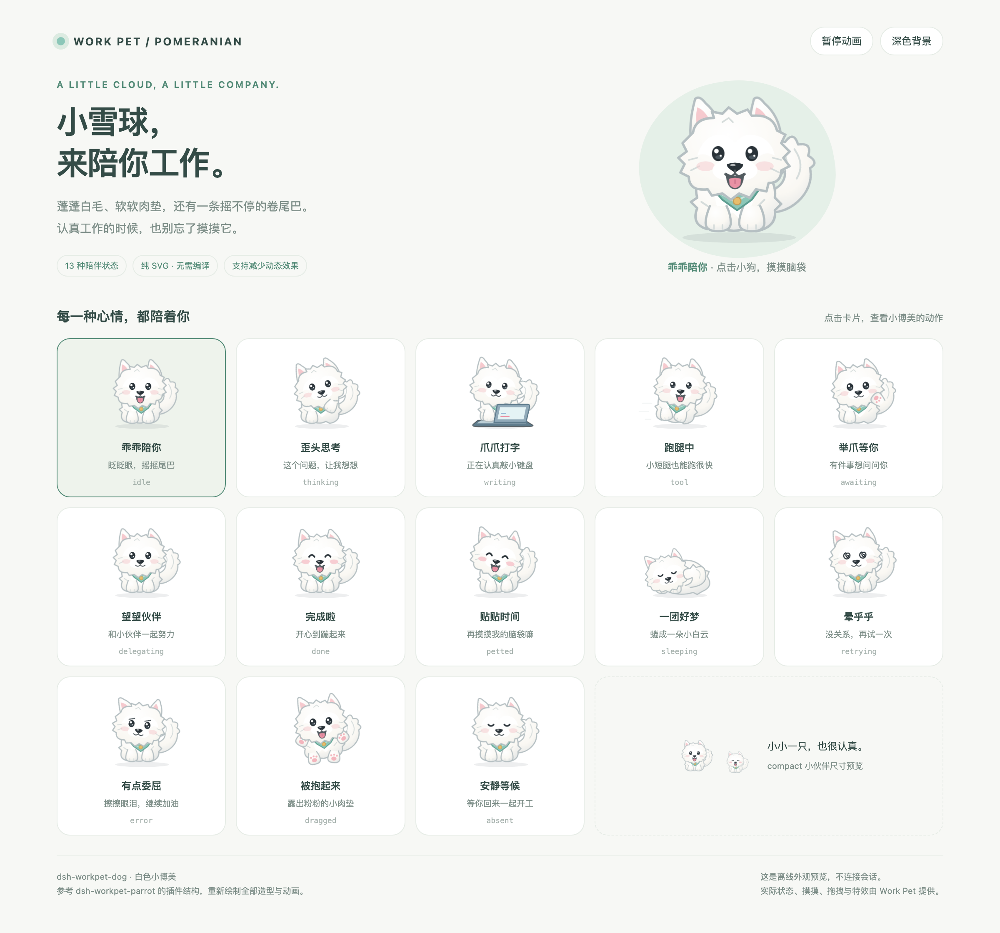

# dsh-workpet-dog

A little cloud with paws: a **white Pomeranian** appearance for the DeepSeek Harness Work Pet.

Fluffy white fur, tiny pointed ears, shiny dark eyes, pink paw pads, a plumed curled tail, and a mint bandana. The plugin structure follows [dsh-workpet-parrot](https://github.com/lastorder/dsh-workpet-parrot); the puppy artwork and animations are newly drawn in SVG.



[中文说明](https://github.com/lastorder/dsh-workpet-dog/blob/main/README.zh.md)

## Preview from a checkout

```sh
pnpm install
pnpm run preview
```

Download or clone the [source repository](https://github.com/lastorder/dsh-workpet-dog), run the commands in its checkout, then open the generated [offline preview](https://github.com/lastorder/dsh-workpet-dog/blob/main/docs/preview.html) **as a local file** in a browser. You can also download the repository ZIP and open `docs/preview.html` locally with its neighboring source files; GitHub's blob page is a source view, not an interactive preview. The page loads the real artwork from [client.js](https://github.com/lastorder/dsh-workpet-dog/blob/main/client.js) and includes all 13 animated poses, a clickable large puppy, pause/resume, light/dark backgrounds, and compact companions. No server or running Harness is needed. The command also regenerates the [plugin icon](https://github.com/lastorder/dsh-workpet-dog/blob/main/icon.svg).

This is an appearance preview, not a connection to a real session. Real dragging, session state and effects belong to Work Pet.

## Install in DeepSeek Harness

Install and enable **`dsh-workpet`** in the same profile first. This prerequisite owns session state, floating pets, dragging, petting, bubbles, badges, companions, hearts and other effects. This package only contributes an appearance.

**Until the first npm publication**, install from a checkout. Ask the Agent in a Harness session to use `plugin_manager`:

```text
install_bundle /absolute/path/to/dsh-workpet-dog
```

CLI-managed profiles may instead use:

```sh
dsh plugin --profile <profile> add link:/absolute/path/to/dsh-workpet-dog
```

**After `dsh-workpet-dog@0.1.0` is actually published on npm**, ask the Agent to install the published bundle by package name:

```text
install_bundle dsh-workpet-dog
```

For a CLI-managed profile, use `dsh plugin --profile <profile> add dsh-workpet-dog`. This npm route is **not available yet**; merely preparing this repository does not publish the package. Installing the published package does not run its development/test/preview scripts in the receiving profile; the `prepublishOnly` verification script runs for a manual npm publish, not for package consumers.

Installation changes the whole profile and requires approval. No installation is performed by this repository. Enabling the bundle adds a separate puppy alongside existing pets; disabling it removes the puppy. Without `dsh-workpet`, the skin waits for its dependency and does not display independently.

After installation, **Plugins → Work Pet** provides appearance cards and activity buttons. After editing a linked checkout, refresh the Harness page; if stale content remains, restart Harness. This project does not run its own Web server or promise automatic HMR.

## Activities

| Activity | Pose |
| --- | --- |
| `absent` | Quietly waiting, eyes closed, slow breathing |
| `idle` | Blinking, little tongue out, wagging its curled tail |
| `sleeping` | Curled into a fluffy cloud with its head on its paws |
| `thinking` | Tilting its head, looking up, paw under its chin |
| `writing` | Alternating tiny paws on a laptop keyboard |
| `tool` | Bouncing along on little running legs |
| `retrying` | Spiral eyes and a gentle wobble |
| `awaiting` | Raising and waving a paw for your attention |
| `delegating` | Listening and looking for its companions |
| `done` | Happy eyes, a little hop and an excited tail |
| `error` | Drooping ears and a little tear |
| `petted` | Happy squint, pink cheeks, leaning into your hand |
| `dragged` | Gently swinging with visible pink paw pads |

## Development

Node.js **22+**. Like the reference, this plugin has **no build step, no TypeScript, no JSX, and no runtime npm dependencies**. Harness provides React. React 18 development dependencies are only for SSR tests and previews.

```sh
pnpm install
pnpm run check     # JavaScript syntax checks
pnpm test          # Rendering, lifecycle and contract tests
pnpm run verify    # Check + test
pnpm run preview   # Regenerate the offline gallery and static icon
```

| File | Purpose |
| --- | --- |
| [client.js](https://github.com/lastorder/dsh-workpet-dog/blob/main/client.js) | Palette, body parts, poses, CSS animations and disposable registration |
| [index.js](https://github.com/lastorder/dsh-workpet-dog/blob/main/index.js) | Empty Host entry |
| [cordis.patch.yml](https://github.com/lastorder/dsh-workpet-dog/blob/main/cordis.patch.yml) | Bundle Loader row |
| [package.json](https://github.com/lastorder/dsh-workpet-dog/blob/main/package.json) | Manifest, dependency ordering and development scripts |
| [English metadata](https://github.com/lastorder/dsh-workpet-dog/blob/main/locale/en.json) / [Chinese metadata](https://github.com/lastorder/dsh-workpet-dog/blob/main/locale/zh.json) | Plugin Manager text |
| [preview.mjs](https://github.com/lastorder/dsh-workpet-dog/blob/main/scripts/preview.mjs) | Offline gallery and icon generation from the actual plugin |

### Artwork rules

- Use `viewBox="0 0 100 80"`; paws rest around y = 71, the shadow at y = 74.
- Palette `P` uses white fur with subtle outlines and shading to remain legible on both light and dark backgrounds.
- `head` controls eyes, tilt, ears, tongue and blush; `tail`, `body`, `foot` and `bandana` are reusable parts.
- Keep gradient IDs local to each instance with `React.useId()`.
- Prefix classes and keyframes with `wpd-` to avoid collisions with the parrot's `wpp-` animations.
- Keep CSS animation transforms on separate groups from SVG `transform` attributes.
- Preserve `prefers-reduced-motion`: the pose remains visible without animation.
- Styles, dictionaries and the skin are registered with `ctx.effect` and removed on disposal. Hard dependencies are `workpet` and `locale`.
- Do not duplicate the Work Pet's status derivation, bubbles, badges, companions or effects.

## Publication checklist (for the owner)

The **public** GitHub repository is `lastorder/dsh-workpet-dog`. The npm package `dsh-workpet-dog` version `0.1.0` is **not published yet**. Do not publish without the owner's confirmation.

1. Before any release, verify the checkout with `pnpm install`, `pnpm run verify` and `npm pack --dry-run`; inspect the tarball file list. Confirm the public GitHub repository and release workflow are ready.
2. For the **one-time initial npm publication only**, after the owner explicitly approves and authenticates, run `npm login` (complete npm's 2FA challenge) and then manually run `npm publish --access public` from the verified package checkout. This is an instruction for a future authorized owner action, **not** an action performed by these docs.
3. Once npm recognizes the package and its owner, configure **npm Trusted Publisher** for GitHub repository `lastorder/dsh-workpet-dog`, workflow filename `.github/workflows/release.yml`, and the appropriate GitHub Actions environment if the workflow uses one. The workflow must be configured for **stage-only** releases: a later annotated version tag stages/verifies the npm release in CI and creates a GitHub **prerelease**; the owner reviews and manually approves npm publication, then marks the GitHub Release as final. Do not let tag creation alone auto-publish to the npm registry.

## Credits and license

Based on the plugin structure of [dsh-workpet-parrot](https://github.com/lastorder/dsh-workpet-parrot), following the `WorkpetScene` / `WorkpetSkin` contract from [dsh-workpet](https://github.com/lastorder/dsh-workpet). MIT; the reference copyright notice is retained in [LICENSE](https://github.com/lastorder/dsh-workpet-dog/blob/main/LICENSE).
